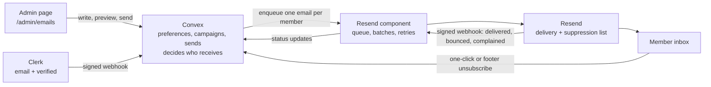

# How Locatic community email works

Locatic emails its members about product news. An admin writes an edition, previews it, sends themselves a test, and sends it to everyone eligible. Members control what they get from Settings or from the link in every email.

> **Status (2026-10-12):** implemented on `feat/community-email` from the design in [`plans/2026-10-11-community-email-design.md`](plans/2026-10-11-community-email-design.md), which also lists where the code differs from the plan. Not deployed: each deployment still needs the backfills below, and `emailVerified` and `notificationPrefs.productUpdates` become required only after them.

## What members receive

| Email           | Default | Who gets it                                                        |
| --------------- | ------- | ------------------------------------------------------------------ |
| Locatic updates | On      | Every active member with a verified email who hasn't turned it off |
| Weekly digest   | Off     | Only members who turned it on. Built, but not sending yet.         |

Nothing is ever sent automatically. Every edition needs an admin to press send.

## The moving parts

Convex owns the member list and makes every decision. Resend only delivers.

| Part                     | Job                                                                                                                                                                         |
| ------------------------ | --------------------------------------------------------------------------------------------------------------------------------------------------------------------------- |
| **Clerk**                | Sign-in, the member's email address, and whether it is verified. Tells Convex about changes through a signed webhook.                                                       |
| **Convex**               | Stores preferences, a log of every preference change, campaigns, and one record per email sent. Decides who receives what. Hosts the unsubscribe endpoint.                  |
| **`@convex-dev/resend`** | The official Convex component for Resend. It runs inside Convex: queues emails, sends them in batches, retries failures, respects rate limits, and reports delivery events. |
| **Resend**               | Delivers each email. Keeps a suppression list so it never retries an address that hard-bounced or reported spam. Holds no copy of the member list.                          |

The browser never talks to Resend and never sees an API key.

## Sending an edition

1. **Write.** Subject, preview text, a body in simple Markdown (paragraphs, bold, HTTPS links, lists), and an optional button. A live preview shows exactly what will be sent. The body is capped so the email stays under Gmail's clipping size. A body link to `{{UNSUBSCRIBE_URL}}` becomes each reader's own unsubscribe link, for an edition that should open with one (such as the first update to existing members).
2. **Test.** Send it to your own address. Test sends only go to an allowlist and carry `[test]` in the subject.
3. **Send.** A confirmation shows an estimate of how many people will receive it, the first few names, and how many are skipped and why. The estimate counts only the first 100 members, so with more members it reads "N+"; sending itself checks everyone. Confirming locks the edition; Convex re-checks that nothing changed since you previewed it, and for digests that every picked project and discussion is still public.
4. **Deliver.** Convex goes through members in batches, oldest account first: up to 100 members a batch, fewer when the email is large, so a batch always fits in one transaction. For each eligible member it builds a personal unsubscribe link, hands the email to the Resend component, and records a send for that member. A member who already has a send for this edition is skipped, so retries never send anyone a second copy.
5. **Track.** As Resend reports back, each member's send moves from queued (waiting in Convex) to sent (handed to Resend; delivery not confirmed) to delivered, or ends as bounced, complained, failed or cancelled. The admin page shows the totals and a per-member list. An address Resend suppresses (for example after an earlier bounce or complaint) never reports back, so its send stays "sent"; Locatic does not yet handle Resend's `email.suppressed` event.

While a send is running, **Stop sending** stops it from reaching anyone else and cancels emails still waiting; afterwards, **Cancel emails not sent yet** cancels whatever is still waiting. Emails already handed to Resend cannot be recalled. If a send ever stops partway, the admin page offers **Resume**, which carries on from where it stopped without sending anyone a second copy.

## Unsubscribing

Every email carries two ways out, and both work without signing in:

- **One-click unsubscribe.** Gmail, Apple Mail and others show their own Unsubscribe button, driven by the `List-Unsubscribe` header. It posts to `https://<deployment>.convex.site/email/unsubscribe`, which turns the preference off at once. A plain visit (GET) to that URL only redirects to the page below.
- **The footer link.** It opens `/unsubscribe` on the site, a page that asks for confirmation before changing anything, because company email scanners open every link in a message. After unsubscribing, the page offers **Stop all Locatic email** and a link to Settings. There is no Undo: turning email back on requires signing in, so a forwarded email can't resubscribe someone.

Each link carries a signed token for one member and one email type, so unsubscribing from updates leaves the digest alone. Links don't expire, and rotating the signing secret keeps old links working for a transition period.

Members can also switch either email type on or off in **Settings → Notifications**. Every change, from any source, is written to a log with the time and where it came from.

If someone reports an email as spam, Convex turns off both email types for them, and Resend stops delivering to that address. This happens once per email, even if that email had already failed or been cancelled. Turning the setting back on doesn't lift Resend's block; Settings keeps telling the member to contact us until their address changes.

The footer says who sent the email and why, links to Settings and the unsubscribe page, and shows a postal address once Locatic has one. Updates stick to news about Locatic itself; promotional email would need that address first.

## Admin access and safety switches

Only Clerk users listed in the Convex variable `EMAIL_ADMIN_CLERK_IDS` are admins. They see an "email campaigns" item in the account menu at the foot of the sidebar, and an "Email campaigns" link in Settings → Notifications (the way in on phones). Everyone else is redirected from `/admin/emails` to Home, and Convex checks admin rights on every request.

| Variable                                   | Effect                                                                                                                                                                                                                                                           |
| ------------------------------------------ | ---------------------------------------------------------------------------------------------------------------------------------------------------------------------------------------------------------------------------------------------------------------- |
| `EMAIL_SENDING_ENABLED`                    | Must be `true` for campaigns to send. Also an emergency stop: switching it off stops a running send at its next batch (the campaign stays "sending" and shows as stalled; press Stop sending to cancel emails already waiting). Resume works once it is back on. |
| `EMAIL_TEST_SENDING_ENABLED`               | Must be `true` for test sends.                                                                                                                                                                                                                                   |
| `EMAIL_TEST_RECIPIENTS`                    | The only addresses test sends may go to.                                                                                                                                                                                                                         |
| `EMAIL_UNSUBSCRIBE_SECRET`                 | Signs unsubscribe links. When rotating, keep the old value in `EMAIL_UNSUBSCRIBE_SECRET_PREVIOUS` for at least 30 days.                                                                                                                                          |
| `EMAIL_POSTAL_ADDRESS`                     | Optional address shown in the footer.                                                                                                                                                                                                                            |
| `RESEND_API_KEY`, `RESEND_WEBHOOK_SECRET`  | Connect the component to Resend. Point the Resend webhook at `https://<deployment>.convex.site/resend-webhook` with `email.sent`, `email.delivered`, `email.delivery_delayed`, `email.bounced`, `email.complained` and `email.failed`.                           |
| `EMAIL_FROM`, `EMAIL_REPLY_TO`, `SITE_URL` | Sender identity and the base URL for links.                                                                                                                                                                                                                      |

With both sending switches off, the component runs in test mode and can only deliver to Resend's test addresses. Campaign sends also need `CONVEX_SITE_URL` (set by Convex) for the one-click link.

## Setting up a deployment

New fields start optional so existing members keep working.

0. **Development deployment only, before deploying this code:** delete PR #32's test data: every document in `email_contacts`, `email_contact_cleanups`, `email_campaign_runs` and `email_campaign_recipients`, and the old-shape documents in `email_campaigns` (they would not validate against the new schema). Production never had them.

Then, on each deployment, after deploying this code:

1. Run `emailMigrations:clearLegacyEmailSubscription` with `{ "cursor": null }`. It removes PR #32's deprecated `users.emailSubscription`, which the schema still allows so the deploy doesn't fail.
2. Run `emailMigrations:backfillProductUpdates` with `{ "cursor": null }`. Existing members get Locatic updates turned on, logged as `backfill` (decision D7). Purged accounts get the field turned off, with no log entry.
3. Run `emailMigrations:backfillEmailVerified` with `{ "cursor": null }`. It reads verification from Clerk (needs `CLERK_SECRET_KEY`). It writes Clerk's value where Clerk's primary address matches the stored one, and `false` for members Clerk no longer has, members with no primary address, or a different primary address. The logs count each case. Members the webhook changed during the run are skipped and named; run it again for them.
4. Check every user has both fields and none has `emailSubscription`. Then, in one change: make `emailVerified` and `notificationPrefs.productUpdates` required in `convex/schema.ts` and the viewer validator, remove `emailSubscription`, and read `productUpdates` directly in `convex/lib/email_audience.ts`.

## Before launch

These are documented by Convex but not yet verified on a deployment (they pass in tests):

- **Web Crypto in mutations.** Run a token sign/verify round trip in a mutation on the development deployment. Fallback: sign tokens in the `requestSend` action and pass them to the batches.
- **One-click form bodies.** POST `List-Unsubscribe=One-Click` to `/email/unsubscribe` on the development deployment, both URL-encoded and multipart. Fallback: parse URL-encoded bodies with `URLSearchParams`.

## What happens when something fails

- **Resend is down or rate-limits us:** the component retries on its own. If retries run out, those emails are marked failed, and a check every 15 minutes copies that result onto the campaign so the admin page shows it. The check looks at sends from the last 25 days only, while the component still has its copies.
- **Convex restarts mid-send:** each batch (up to 100 members) is one transaction, so a batch either fully happens or not at all, and the next batch starts from a saved position.
- **A batch hits a bug:** the send stops with the campaign still "sending". The admin page shows **Resume** after five minutes without progress.
- **A member opts out mid-send:** their emails of that type still waiting in the queue are cancelled; the other type is untouched. The opt-out itself always takes effect, even if their email was already handed to Resend. Emails queued after a member turns email back on are not cancelled by the earlier opt-out.
- **An email is too big:** each recipient's copy (HTML and plain text) is capped at 120 KB, checked at preview, test and send, so a batch of emails always fits Convex's per-transaction limits. Long reference links repeated many times are the usual cause.
- **An address changes or loses verification:** the Clerk webhook records it and cancels that member's waiting emails; Settings ignores bounces from before the change.

## Data kept

Send records store the member's ID, not their address. The component's own copies, which include addresses, are deleted 30 days after they finish, or after 60 days if they never finished. When an account is purged, its send records and preference log go with it, and old unsubscribe links for it no longer record anything.

## Where to look in the code

| To change                       | Look in                                                                                                              |
| ------------------------------- | -------------------------------------------------------------------------------------------------------------------- |
| Admin page                      | `src/routes/_app/admin/emails.tsx`, `src/features/email-campaigns/`                                                  |
| Drafts, send start, cancel      | `convex/emailCampaigns.ts`                                                                                           |
| Rendering, preview, test sends  | `convex/emailRender.ts` (Node), `convex/lib/emails/`                                                                 |
| Batches, delivery events, purge | `convex/emailSends.ts`, `convex/lib/email_send_status.ts`, `convex/lib/resend.ts`                                    |
| Who receives what               | `convex/lib/email_audience.ts`, `convex/lib/email_campaigns.ts` (content limits)                                     |
| Preferences and unsubscribe     | `convex/emailPreferences.ts`, `convex/lib/email_preferences.ts`, `convex/lib/unsubscribe_token.ts`, `convex/http.ts` |
| Unsubscribe page                | `src/routes/unsubscribe.tsx`, `src/features/email-preferences/`                                                      |
| Settings switches               | `src/features/settings/email-preferences-section.tsx`, `src/routes/_app/settings.tsx`                                |
| Backfills                       | `convex/emailMigrations.ts`, `convex/lib/clerk_users.ts`                                                             |
| Digest drafts (off), crons      | `convex/emailDigest.ts`, `convex/crons.ts`                                                                           |
| Design and decisions            | `docs/plans/2026-10-11-community-email-design.md`                                                                    |

## Sources

- [Convex Resend component](https://github.com/get-convex/resend)
- [Resend: unsubscribe headers for API sends](https://resend.com/docs/dashboard/emails/add-unsubscribe-to-transactional-emails)
- [Resend: quotas and limits](https://resend.com/docs/knowledge-base/account-quotas-and-limits)
- [RFC 8058: one-click unsubscribe](https://www.rfc-editor.org/rfc/rfc8058)
- [Convex scheduled functions](https://docs.convex.dev/scheduling/scheduled-functions)
