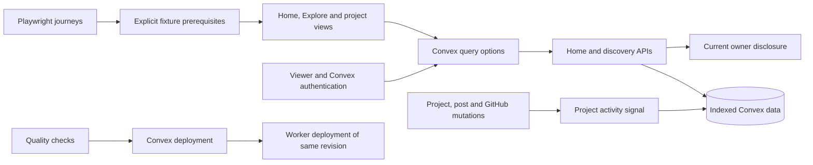

# UX implementation review fixes

Scope: correct the staged UX implementation without changing its approved product direction. Keep the existing framework and feature boundaries. Do not deploy or change production data during this work.

## Architecture and flow



## Production and test paths

```text
Production:
  MemberShell
    -> notificationsUnreadCountQueryOptions(ready)
      -> Convex skip arguments while authentication is pending
      -> notifications.unreadCount after authentication
  Explore route
    -> discovery search query options with active filters
      -> explore.searchProjects / searchBuilders
        -> bounded indexed candidates, filters, then result limit
  home.list
    -> enrichTarget
      -> live owner disclosure applied to current and fallback snapshots
  Project/post/GitHub mutations
    -> maintained project activity signal
      -> computeLastPublicActivityAt
        -> owner/visibility/activity index
  CI workflow completion
    -> environment-scoped deployment job at the validated commit
      -> Convex deployment succeeds
        -> Worker build and deployment

Tests:
  Convex contract tests
    -> convex-test in-memory database with real schema and functions
      -> privacy transitions, filtered search and >50-project activity
  Subscription regression
    -> real ConvexQueryClient with fake transport
      -> no unread subscription until authenticated viewer is ready
  Project view tests
    -> mocked query/mutation boundaries
      -> owner actions and project interactions survive component extraction
  Playwright journeys
    -> explicit configured deployment/persona prerequisites
      -> actual settled UI; application failures remain failures
```

## Implementation order

1. Correct snapshot privacy, search filtering and the unread subscription guard, with focused regressions.
2. Replace truncated activity recomputation with an indexed signal and a migration path for existing projects. Keep individual writes and backfill batches bounded.
3. Simplify E2E prerequisite handling and extract cohesive project owner controls from the project view. Remove styling-expression assertions already covered by token checks.
4. Include required scripts, allowlists, fonts and licences in the index. Preserve unrelated untracked files.
5. Serialize backend and frontend deployment in one environment lock. This changes workflow configuration only; it does not run a deployment.
6. Run quality/build checks against the finished staged tree, and report browser prerequisites honestly.

## Risks and verification

- Existing deployments require the new schema/functions and activity backfill before their ranking is considered verified. A scheduled backfill being accepted is not evidence of completion.
- A bounded recent search is not a global full-text search. Its UI must describe that boundary rather than claim exhaustive absence.
- Tests must assert the original failure cases, not duplicate implementation details or suppress application errors as deployment skew.
- Large-owner and large-city operational costs require representative data. Do not infer database cost savings from unit tests or the removal of Pulse scheduling.
- Run `pnpm ci:quality` and `pnpm ci:build`; inspect a clean index export for missing files. Public/authenticated E2E and OAuth results must state which deployment and fixture prerequisites were actually available.

## Initial rollout requirements

The combined deployment job enforces backend-before-frontend ordering. It does not run one-off migrations. Before merging this initial UX release into an automatically deployed branch, the operator must deploy its backend and complete the existing owner-state, city-stat and notification-target backfills, plus `users:backfillLastPublicActivity`. That activity command now migrates project rows and then users automatically; wait for its structured log with `job: "backfillLastPublicActivity"` and `status: "complete"`, not merely a successful initial invocation. No deployment or production backfill was performed while addressing this review.

The larger-owner regression verifies privacy propagation across 56 projects. It does not certify production database limits: owner-state synchronization still reads the owner's rows, and city recount reads the city's members/projects. These operational bounds and actual Pulse cost savings remain measurement tasks, not claimed improvements.

Strict E2E preflight currently requires the missing `E2E_PUBLIC_PROFILE_USERNAME`, `E2E_CLERK_EMPTY_CITY_USER_EMAIL` and `E2E_CLERK_ONBOARDING_USER_EMAIL` fixtures. Existing populated-route screenshots must be reviewed against prepared fixtures after deployment; the visual tests now reject empty populated-persona pages and application error states before comparing images.

## UI refresh follow-up

Scope: fix the remaining reported UI defects and sharpen the visual system without changing the approved product direction (dark, lowercase, mono-led; teal, violet and amber themes).

- **Reported defects.** Reaction chips and inline controls used 44px targets on every pointer, which inflated reaction chips, spread out owner-card links and pushed the reaction row into the topic editor. 44px targets now apply only on coarse pointers, and desktop controls are 24–32px. Reactions are compact pills; only the disabled action fades, so the still-usable reactor count keeps full contrast. Owner-card and profile social links share one component, which adds Bluesky and restricts LinkedIn links to LinkedIn hosts.
- **Authentication races.** The notifications, inbox and settings loaders now skip private queries until Convex authentication is ready, as Home, Profile and Explore already did. `Unauthorized` shows a session-ended state with both sign-in and retry. Retry clears React Query's error boundary before invalidating the router. Error details are shown only in development (`import.meta.env.DEV`), not in deployed development-mode builds.
- **Visual system.** Self-hosted Geist and Geist Mono replace IBM Plex. Surfaces use a neutral near-black with hairline separation, text uses two tiers, the accent is more saturated, and there are new `live` and eyebrow roles. Contrast gates cover all three themes.
- **Explore.** Project cards are people-first rows. Filters, city stats, active builders and nearby cities sit in a rail at `xl` and in a sheet below it. The builder list keeps fetching past sparse filtered pages up to the existing auto-fetch limit. `cities.listNearby` reuses the bounded nearby-cities reader. Relative times and live indicators render after hydration from one shared clock.
- **Landing.** A dot-map hero pings cities with real public activity. It pauses when hidden or off-screen, has a pause control, respects reduced-motion changes at runtime, and uses a labelled example map below the city threshold. The parallax and the separate showcase card are removed.

### Additional rollout requirements

- Deploy the backend before the frontend so `cities.listNearby` exists. Until it does, the rail omits nearby cities rather than showing an error.
- The motion chunk budget is now 27 KiB. Removing the parallax folded a separate motion helper chunk into it. The current 26.89 KiB leaves little headroom.
- Visual baselines were refreshed only where they already existed, and against local development data. The missing Explore, city, saved, own-profile and own-project baselines still need prepared fixtures.

### Verification

`pnpm ci:quality` (1,190 tests) and `pnpm ci:build` pass. Playwright ran in smoke mode against local development: 113 passed, and the persona-dependent specs were skipped. The only functional failure is the `javascript:` sign-in destination spec, where Clerk's firewall blocks the development handshake before the app's redirect sanitisation, which behaves correctly when requested directly. The strict E2E personas listed above are still required for a release run.
