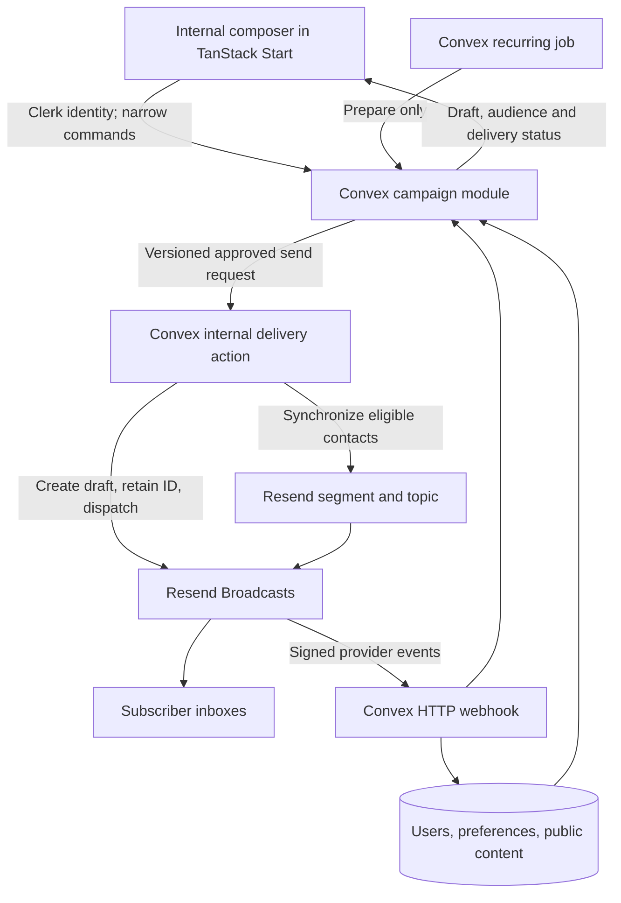

# Community Email Implementation Plan

> **Superseded (2026-10-11):** the subscription, review and delivery design below is replaced by [`2026-10-11-community-email-design.md`](2026-10-11-community-email-design.md). Keep this file as the record of the original plan and its implementation findings.

> **For the implementing agent:** Use the executing-plans skill to implement this plan task by task. Follow the nearest AGENTS.md. Do not delegate, commit, deploy, synchronize production contacts, or send real emails without the user's authorization for that action.

**Goal:** Let Locatic admins compose community/shipping updates and review automatically prepared fortnightly digests before sending them to eligible subscribers.

**Architecture:** The existing TanStack Start application hosts the internal composer. Convex owns authorization, campaign state, subscriber eligibility, draft preparation, and durable send requests; Resend Broadcasts owns bulk delivery and provider unsubscribe enforcement. Every edition requires a human send decision.

**Tech Stack:** Existing TypeScript, React, TanStack Start, Convex, Clerk, Tailwind v4, Vitest/convex-test, and Playwright; add Resend SDK and React Email rendering after checking current runtime compatibility.

---

## Status and scope

Design decisions agreed in chat on 2026-09-28: structured composer, automatic fortnightly drafts, explicit manual sending, recent public activity plus editorial selection, existing app with Convex execution and Resend delivery. This document is a planning deliverable, not authorization to implement or send. No production database, Resend account, domain configuration, or subscriber totals have been inspected.

### Implementation findings, 2026-09-28

- Local implementation is authorized; production configuration, contact import, deployment, and real email delivery remain unauthorized.
- Selected runtime versions: `resend@6.28.1` and `@react-email/render@2.1.0`. The renderer supports Node 20+ and React 19, matching this repository's Node 24 and React 19 runtime.
- The current Resend API uses Segments for broadcast recipients; the older Audience API is deprecated. Contacts can be created with explicit segment membership and topic subscriptions using `opt_in` or `opt_out`.
- `contacts.unsubscribed` is a global Broadcast opt-out. Locatic never writes it back to `false` during routine synchronization, because doing so could clear a provider-managed unsubscribe.
- Broadcast status values documented by Resend are `draft`, `scheduled`, `queued`, `sent`, and `canceled`. Unknown values map to `needs_attention`. A retrieved draft after an uncertain send is not treated as sent and is not blindly resent.
- Resend documents contact, suppression, and per-recipient email webhooks. Email event payloads can carry `broadcast_id`; no broadcast-completed webhook is assumed.
- Production audience totals and historical consent provenance were not inspected. First import and first customer send remain blocked on that audit.
- `pnpm convex codegen` completes against the configured development deployment after renaming the email template module to a Convex-safe underscore path. The generated Convex bindings were refreshed by the generator; no generated file was edited by hand.
- The TanStack route generator ran as part of the local production build and generated the `/admin/emails` route entry. No route-tree code was edited by hand.
- `pnpm ci:quality` passes: formatting, lint, contrast, arbitrary-value, bounded-query and design-token gates; TypeScript; and 1,141 tests across 180 files. The existing combobox and contribution-graph accessibility lint warnings are resolved without removing either control's keyboard behavior.
- `pnpm ci:build` and the client bundle budget pass. Wrangler prints a sandbox-only log-file permission warning while Vite builds, but the build exits successfully and the bundle check passes.
- The authenticated email-workspace Playwright scenario is discoverable under `chromium-authenticated`. It was not executed because this repository's E2E harness targets the configured external Convex/Clerk development environment, which has not been deployed or prepared with the newly documented allowlisted admin and reusable draft fixture.
- Audience review is deliberately bounded to 500 total contact rows in this v1 local implementation, including ineligible rows. The conservative ceiling keeps review, exclusion counts, and frozen recipient snapshots inside one bounded Convex transaction. At 501 rows the workflow fails closed with an operator error; production totals must be audited before launch, and a paginated/materialized audience workflow is required before raising the ceiling.
- Provider segment and Broadcast creation use persisted phase checkpoints, deterministic identities, bounded paginated reconciliation, idempotency headers, due-work indexes, and atomic create/send claims. Ambiguous mutation outcomes reconcile before any repeated provider mutation.
- Contact synchronization uses indexed due retries and expiring claims so permanent failures cannot starve later work. Account purges and stale worker completions retain only a cleanup-scoped provider contact ID in a durable deletion queue until provider deletion succeeds.
- Admin cancellation is available only before Broadcast handoff. Cancellation is terminal against late workers, preserves any segment-cleanup obligation, and is never presented as recall.
- No deployment, production read, provider contact import, real test email, Broadcast creation, or customer delivery occurred during implementation.

### In scope

- One shared community/product-update subscription category.
- Manual one-off announcements and recurring digest drafts using one versioned template.
- Subject, preheader, introduction, zero to five selected projects, zero to two discussions, and optional Locatic shipping text. Digest suggestions target three to five projects; short editions remain possible. One-off announcements need no project selection.
- Save, preview, send test, review audience, explicitly send, inspect status.
- Admin-only access, immutable approved revision, unsubscribe synchronization, safe retries, and operational error feedback.

### Deferred

- Freeform rich-text/HTML editor, drag-and-drop layouts, arbitrary template variables, AI copy generation.
- Automatic sending, city/personalized editions, separate admin deployment, A/B tests, arbitrary segmentation, a general automation engine, and custom delivery queues per recipient.
- Separate weekly/fortnightly choices per user. The initial cadence is fortnightly for everyone subscribed.
- A ranking algorithm or popularity leaderboard. Counts, if included, are labeled lifetime counts as of preparation, never weekly growth.

## Repository evidence

- `convex/schema.ts`: users have `email`, `notificationPrefs.weeklyDigest`, lifecycle fields, public project metadata, and timestamped comments. No campaign tables exist.
- `convex/lib/viewer.ts`: `weeklyDigest` defaults to false. `convex/users.ts:updateNotificationPrefs` persists it; `src/routes/_app/settings.tsx` renders it. Do not bulk flip false values to true.
- User describes existing enrollment as default-on with opt-out. Reconcile this claim with actual stored values and signup wording before first production audience import. Do not invent explicit-consent timestamps for old accounts.
- `convex/crons.ts`: scheduled maintenance exists, but no digest task.
- `convex/http.ts`: existing verified Clerk webhook entry point; `webhook_events` provides a provider/event deduplication model.
- `convex/lib/auth.ts`: identity/viewer helpers exist; inspected code does not provide an admin capability suitable for campaigns.
- `convex/lib/activity.ts`: project public activity covers releases, live posts, and commits. It does not treat likes/comments as project activity. Metadata freshness depends on existing bounded GitHub refresh jobs.
- `convex/pulse.ts`: Pulse is retired. Do not revive its remaining lifetime-count ranking helper.
- `docs/PRODUCT.md` and `docs/DESIGN.md`: preserve editorial discovery, server-side privacy, existing Plex typography, semantic tokens, and shared controls.
- `convex/comments.test.ts` and `convex/__tests__/fixtures.helpers.ts`: existing convex-test pattern and privacy fixtures.

## HLD: architecture and flow



Convex is the only application execution authority. The browser submits intent and subscribes to state; it never receives Resend credentials or loops over recipients. Admin route protection improves UX, while every public backend operation independently authorizes the caller. Resend is an external nontransactional boundary: a Convex transaction cannot atomically commit a provider send.

## LLD: implementation and calls

All new paths/symbols below are proposals. Existing integration points are identified explicitly. Generated API and route-tree changes must come from the project's generators, never manual edits.

```text
Production: manual campaign
  src/routes/_app/admin/emails.tsx [new route]
    -> src/features/email-campaigns/components/campaign-workspace.tsx [new]
      -> convex/emailCampaigns.ts: saveDraft / prepareReview / requestSend [new]
        -> convex/lib/email_admin.ts: requireEmailAdmin [new]
          -> existing convex/lib/auth.ts identity and active-user lookup
        -> campaign/revision validators + optimistic revision check
        -> commit immutable review artifact and send intent
          -> ctx.scheduler.runAfter -> internal.emailDelivery.dispatch [new]
            -> internal eligibility/content revalidation
            -> emailContacts.claimPending [indexed due queue + expiring lease]
            -> email_contact_cleanups [provider-ID-only deletion tombstone]
            -> render template in Node action [new]
            -> Resend Broadcasts create (send=false)
            -> internal mutation stores broadcast ID
            -> Resend Broadcasts send persisted ID
            -> persist accepted state OR needs_attention on ambiguous result

Production: recurring preparation
  existing convex/crons.ts
    -> internal.emailCampaigns.prepareDueDigest [new]
      -> transactional period-key deduplication
      -> indexed public-project candidates + public discussion candidates
      -> materialized draft for [periodStart, periodEnd)
      -> never calls requestSend or delivery automatically

Production: subscription updates and provider feedback
  existing convex/users.ts:updateNotificationPrefs / lifecycle updates
    -> versioned contact-sync intent -> internal.emailContacts [new]
  existing convex/http.ts, new /resend/webhook route
    -> signature validation over raw request body
    -> internal.emailEvents.record [new]
      -> provider/event-ID deduplication using existing webhook_events
      -> subscription/suppression or monotonic delivery update

Tests:
  convex/emailCampaigns.test.ts / emailContacts.test.ts / emailEvents.test.ts [new]
    -> convex-test schema, existing fixtures and fake time
      -> real public/internal campaign functions and stored state
        -> mocked Resend HTTP boundary, including lost responses
  src/features/email-campaigns/__tests__/campaign-workspace.test.tsx [new]
    -> Testing Library + mocked Convex responses
      -> editing, revision conflicts, review and send actions
  playwright/email-campaigns.authenticated.spec.ts [new]
    -> dedicated test admin, seeded draft, provider test boundary
      -> preview -> test send -> review -> request send -> status
```

## Data and contracts

Keep this behavior in a cohesive campaign module, with separate Node/provider files only where runtime or external I/O requires it. Avoid a generic multi-provider framework. Reuse Convex-generated types and runtime validators, with discriminated unions for states instead of complex type machinery.

### Campaign storage

Add `email_campaigns` with kind (`announcement` or `digest`), draft revision, template version, structured content, source IDs, reporting window, state, timestamps, and creator/updater IDs. Index digest period key and status/update time. A transaction that queries the period index and inserts if absent enforces one edition per period; an index alone is not a uniqueness constraint.

Add `email_campaign_runs` for the immutable approved revision: rendered HTML/text, source-content fingerprint, intended audience cutoff/summary, actor, request ID, provider broadcast ID, stage, retry metadata, and sanitized failure details. A unique application-level campaign/revision send intent prevents repeated clicks from creating more runs. Restrict revision payload sizes and block edits while a run is active. Sent campaigns remain immutable; reuse starts a new draft.

Suggested run stages: `preparing`, `ready`, `dispatch_requested`, `creating`, `sending`, `accepted`, `needs_attention`, `failed`, `cancelled`. Provider acceptance is not proof of inbox delivery. Retain separate delivery/bounce/complaint metrics rather than collapsing all recipients into a single delivered boolean.

### Subscription storage

Keep `users.notificationPrefs.weeklyDigest` as the existing preference in v1. Change visible copy to describe community/product updates and the approximate cadence, without changing values. Add an `email_contacts` record keyed by user with normalized current address, provider contact ID, preference version, acknowledged sync version, last sync outcome, and suppression state. Record real preference changes with source/time; historical true values are legacy enrollment with unknown provenance unless evidence exists.

Eligibility: enabled existing preference, active nondeleted account, usable verified address from trusted Clerk data, no local or provider unsubscribe/suppression, and completed synchronization. Current schema does not prove address verification; implement trustworthy primary-email verification synchronization before relying on that condition. Missing verification is an exclusion, not a guessed true value. Reject placeholder `.invalid` addresses.

Use one Resend segment for eligible Locatic users and one community/product-updates topic. Configure topic behavior to require explicit membership synchronization; verify actual SDK enum semantics against the provider documentation. Do not infer semantics from the English label alone. Store only the contact data needed for delivery. Deduplicate recipient addresses; resolve conflicting account preferences conservatively as excluded pending review.

An explicit settings action may request subscription, but a routine profile/contact upsert must never clear provider unsubscribe or hard-bounce/complaint suppression. If a user wants to reverse a provider unsubscribe, implement a deliberate resubscribe path after verifying provider semantics; otherwise explain the pending state. No automatic suppression removal in v1.

## Content and editorial workflow

1. A daily cron checks whether an anchored 14-day UTC period has ended. The anchor is chosen during activation and stored, not derived from deployment time. Create only the latest due edition after downtime; do not create a backlog of stale campaigns automatically.
2. Add a project index over `exploreOwner.isEligible` and `locatic.lastPublicActivityAt`. Read descending bounded pages for the fixed window, rechecking live public/discovery eligibility. Project signals must be populated; report incomplete coverage rather than silently scanning all projects.
3. Deduplicate by project, propose up to five, and explain the signal/date. Do not claim a complete event history: the timestamp is the latest known activity, and delayed preparation can miss a project whose latest activity has moved beyond the window. This is an editorial candidate list. Expose the reporting period and preparation time, and allow manual replacement through bounded public-project search.
4. Find up to two discussion suggestions using `comments.by_created_at`, paginated within the period. Resolve the live target, exclude deleted/inaccessible content, deduplicate threads, and show a link and editorial summary rather than automatically quoting people's comments. Exhaustion limits produce an honest partial-candidate notice.
5. Save source IDs and selected display snapshots. Use live public/discovery and location privacy rules; public interactability alone does not imply eligibility for promotional discovery. Never use privileged admin visibility to bypass public-content checks.
6. The admin edits structured fields, reorders selections, previews the exact rendered artifact, and sends a test to an admin-controlled allowlisted address. The test uses the same content revision with a clear test marker. Browser preview is sandboxed. Links are validated; raw HTML and executable content are unsupported.
7. Review displays sender/reply-to, subject, revision, period, eligible/excluded counts, synchronization health, and approximate preparation time. `requestSend` references the reviewed revision; stale revision or unresolved eligibility fails closed.
8. Revalidate live selected content before dispatch. Material changes, deletion, or privacy changes require a refreshed preview and renewed approval. Do not quietly substitute projects after approval. Once provider dispatch begins, email content cannot be recalled or continuously updated.

No-content periods create an empty draft with an explanation, never filler or an automatic send. Likes/comments shown in the template are optional lifetime totals captured in the reviewed revision. Preserve minimal source snapshots only as long as operationally necessary; account deletion must clear relevant contact PII and respect the existing deletion policy.

## Delivery, synchronization, and failure semantics

- Commit send intent and scheduler enqueue in the same mutation. Network work happens in internal actions. Scheduled actions are not assumed to retry themselves; store stages and retry decisions explicitly.
- Serialize provider-changing work for the same campaign and contact. Use persisted stage claims plus preference revisions; re-read local desired state after external updates and converge to the newest version. Contact upserts must not overwrite suppression fields.
- Page through the audience with an approved cutoff; new subscribers are excluded from the current edition, while subsequent opt-outs/deactivations remove eligibility. Reconcile segment membership before dispatch. Freeze admissions for the active campaign while allowing removals; serialize broadcasts in v1 to avoid segment membership crossing between campaigns. Once dispatch is confirmed, resume normal synchronization.
- Display a count captured at review time, not a guaranteed exact delivery count. Removals may reduce it. A change that expands the audience requires another review. Do not expose the complete email list to the browser just to calculate counts.
- Block dispatch while relevant contact-sync jobs are unresolved, and recheck immediately before calling send. Convex and Resend cannot share a transaction: an opt-out/privacy change during provider handoff has a race window, and already dispatched messages cannot be recalled. Verify actual provider audience snapshot/unsubscribe timing with controlled contacts before launch; do not promise zero-race semantics.
- Create provider broadcasts as drafts, persist their IDs, then send. If create times out, an orphan draft is harmless but must be reconciled before creating another. If send times out or process execution stops after the call, move to `needs_attention`, retrieve provider state, and never resend blindly. Lack of a documented definitive answer requires manual resolution.
- Retry safe reads and demonstrably rejected transient operations with bounded backoff and `Retry-After`. Treat ambiguous network/5xx outcomes on mutation endpoints as reconciliation cases. Never claim exactly-once external delivery.
- Allow abandoning drafts and cancelling undispatched local requests. Do not present cancellation as recall after provider acceptance.
- Verify signed webhooks over the raw body; reject invalid signatures. Deduplicate provider event IDs. Preserve delivery facts across out-of-order events. A late delivered event cannot clear a bounce/complaint suppression. Retrieve current provider subscription state when a contact event is insufficient to decide a change.
- Provider opt-out -> local preference off; settings opt-out -> immediate local off plus durable provider update. Pending synchronization is visible and prevents another send. Delivery events must be correlated using provider IDs; confirm available Broadcast payload fields in the integration spike.
- Resend secrets live only in Convex environment configuration. Local/dev environments default to sending disabled and controlled test addresses. Use a monitored reply-to and authenticated sending domain; configure SPF/DKIM/DMARC and unsubscribe footer before launch.

## Composer shape

Product register: an operator preparing an edition during a normal desktop work session, within Locatic's existing dark app. Reuse the existing theme and semantic tokens rather than create an admin design system.

- Campaign list: simple rows showing title, kind, period, updated time, and readable status.
- Workspace: labeled subject/preheader fields, introduction/shipping text areas, selected-content rows with accessible move up/down/remove controls, and a desktop preview alongside. On small screens, edit/preview tabs.
- Review: inline dedicated step, with audience exclusions and send progress clearly separated from preview. A precise action such as `send to 123 subscribers` requires a fresh review artifact.
- Keyboard-accessible controls, visible focus, inline errors, dirty-state handling, and explicit stale-save conflicts. No optimistic success for external sending.
- Email uses its own email-compatible inline styles, fallbacks, layout, and plain text. App Tailwind/OKLCH styling is not copied directly into email clients. React Email rendering runs in a Node-compatible action; verify preview/test/send parity.

## Implementation tasks

Each numbered step is a small implementation/check action; split broad file work into focused patches. Run the stated focused command first to expose missing behavior, then implement and repeat until it passes. No tests should assert implementation-only details. No automatic commits are part of this plan.

### Task 1: Verify the provider contract and existing audience

**Files:** update this plan with findings; later create `convex/emailContacts.test.ts` fixtures for observed payloads (synthetic/anonymized only).

1. Confirm installed/new SDK compatibility with Convex Node actions and React Email. Record exact selected versions.
2. Verify Broadcast draft/send/retrieve status behavior, ambiguous retry handling, recipient selection timing, contact updates, topic/global unsubscribe behavior, and event correlation from official documentation.
3. Add fixture-driven tests for observed provider shapes and unknown statuses; unknown values must become `needs_attention`, never success.
4. With separately authorized read access, report aggregate user preference counts, missing/unverified emails, inactive accounts, duplicates, and legacy provenance. Do not export addresses or change preferences.
5. Use controlled provider contacts only when test-send/contact creation is authorized. Until then, mark external semantics unverified. Any unsupported guarantee changes this plan before delivery implementation.

**Verification:** `pnpm exec vitest run convex/emailContacts.test.ts`; payload/state tests pass. First production import remains blocked on audience reconciliation, not on planning or local development.

### Task 2: Campaign state, authorization, and draft persistence

**Create:** `convex/emailCampaigns.ts`, `convex/emailCampaigns.test.ts`, `convex/lib/email_admin.ts`, `convex/lib/email_campaigns.ts`.
**Modify:** `convex/schema.ts`, `convex/lib/validators.ts`.

1. Add convex-test cases for anonymous/nonadmin/inactive-admin rejection, authorized draft creation, malformed content, stale edits, and duplicate send intent.
2. Add minimal schemas/indexes and server-side admin allowlist by Clerk subject. Keep provider IDs/sender addresses server-controlled.
3. Implement `createDraft`, `saveDraft`, paginated `list`, `get`, `prepareReview`, and `requestSend` with argument/return validators. Saving uses `{campaignId, expectedRevision, content}`; sending uses `{campaignId, reviewedRevision, reviewId}`.
4. Verify concurrent requests create one run and that edits invalidate reviews. Keep privileged helpers internal.
5. Generate Convex types using the configured development workflow only; never manually edit generated output or push production changes for type generation.

**Verification:** `pnpm exec vitest run convex/emailCampaigns.test.ts`; authorization and race tests pass. `pnpm typecheck` passes after configured code generation.

### Task 3: Subscription reconciliation and webhook handling

**Create:** `convex/emailContacts.ts`, `convex/emailEvents.ts`, matching `.test.ts` files.
**Modify:** `convex/schema.ts`, `convex/http.ts`, `convex/users.ts`, relevant `convex/lib/clerk.ts` / auth synchronization helpers after reading their callers, `src/routes/_app/settings.tsx`, relevant existing users/settings tests.

1. Test existing false preference, missing verification, account deactivation/deletion, email change, duplicate addresses, provider unsubscribe, and provider suppression exclusions.
2. Persist trusted primary-email verification and preference/sync revisions. Keep every existing preference unchanged during migration.
3. Add paginated contact reconciliation and narrow calls from preference and lifecycle changes. Email changes revoke old membership before admitting the new verified address.
4. Add signed webhook processing and event-ID deduplication. Test replay, stale events, subscription conflicts, suppression precedence, and failed synchronization.
5. Update settings copy and honest sync feedback. Add tests ensuring unrelated notification changes never re-enable email or clear suppression.

**Verification:** `pnpm exec vitest run convex/emailContacts.test.ts convex/emailEvents.test.ts convex/users.test.ts src/routes/__tests__/settings-save-error.test.tsx`; focused cases pass.

### Task 4: Shared email rendering and controlled test sends

**Create:** `convex/emailRender.ts`, `convex/lib/emails/community_update.tsx`, `convex/lib/emails/community_update.test.tsx`.
**Modify:** `package.json`, `pnpm-lock.yaml` for verified dependencies only.

1. Test announcement-only content, selected projects, empty optional sections, text escaping, unsafe URLs, long content, unsubscribe placeholder, and plain-text output.
2. Implement one renderer/template with fixed allowed fields and version. Enforce reasonable field limits in runtime validators.
3. Produce a persisted preview artifact for a revision; use the same artifact for test/send. The preview never executes supplied HTML/scripts.
4. Add admin-only test sending with recipient allowlist, rate limits, test marker, and sending-disabled defaults outside production.

**Verification:** `pnpm exec vitest run convex/lib/emails/community_update.test.tsx`; content/security tests pass. Actual Gmail/Outlook/mobile rendering remains a controlled-inbox launch check.

### Task 5: Durable Broadcast dispatch and reconciliation

**Create:** `convex/emailDelivery.ts`, `convex/emailDelivery.test.ts`.
**Modify:** campaign functions, contact synchronization, webhook correlation as needed.

1. Write fault-injection tests for process stops before/after create/send, lost responses, 429, invalid credentials, stale content, and newly opted-out users.
2. Implement atomic local stage claims, approved audience admission cutoff, per-campaign/provider IDs, bounded contact preparation, and stored checkpoints.
3. Implement draft creation, persistence, send, retrieval, and bounded reconciliation. An unresolved external outcome must not be automatically converted into a second send.
4. Test serialized campaigns, increasing-audience rejection, opt-out during preparation, webhook reorder, and browser disconnect.
5. Expose actionable status and safe recovery only. Add a global send-disable control and sanitization for errors/logs.

**Verification:** `pnpm exec vitest run convex/emailDelivery.test.ts convex/emailCampaigns.test.ts convex/emailEvents.test.ts`; tests demonstrate one application send intent and conservative uncertain-outcome behavior, not universal exactly-once delivery.

### Task 6: Fortnightly editorial draft preparation

**Create:** `convex/emailDigest.ts`, `convex/emailDigest.test.ts`.
**Modify:** `convex/schema.ts`, `convex/crons.ts`.

1. Test fixed half-open period boundaries, repeated/concurrent cron invocations, downtime, empty content, public/private transitions, hidden locations, and duplicated project/thread candidates.
2. Add the public-activity candidate index and bounded candidate reads, checking current privacy through existing helpers.
3. Implement one draft per anchored period, deterministic candidate ordering, and preparation diagnostics. Add the daily due-period check only; no automatic dispatch.
4. Test that editorial saves survive subsequent cron runs and that older draft content is never silently regenerated.

**Verification:** `pnpm exec vitest run convex/emailDigest.test.ts convex/activity.test.ts`; draft-only behavior and privacy tests pass.

### Task 7: Internal campaign workspace

**Create:** `src/routes/_app/admin/emails.tsx`, `src/features/email-campaigns/{queries,mutations,contracts}.ts`, `src/features/email-campaigns/components/campaign-workspace.tsx`, `src/features/email-campaigns/__tests__/campaign-workspace.test.tsx`.
**Modify:** `src/integrations/convex/query-options.ts`; route/navigation integration only as needed after checking existing auth routing.

1. Complete the requested frontend skills' UI preflight before UI edits, using this approved structured-composer scope and existing product/design context. A rendered mock is optional for this utility surface; record the reason if skipped.
2. Test admin denial, loading/errors, editable fields, selection replacement/reordering, save conflicts, and dirty navigation.
3. Compose the campaign list and editor with existing shared components. Use local state for unfinished edits and Convex state for durable campaigns.
4. Add revision-bound preview, controlled test send, inline review, precise audience count/exclusions, and explicit send status. Disable repeat clicks for UX; rely on backend idempotency for correctness.
5. Test blocked sends, stale reviews, failed tests, pending sync, accessible keyboard controls, and narrow screens.

**Verification:** `pnpm exec vitest run src/features/email-campaigns/__tests__/campaign-workspace.test.tsx`; UI contract tests pass. Route tree changes are generated.

### Task 8: Integrated verification and launch preparation

**Create:** `playwright/email-campaigns.authenticated.spec.ts`.
**Modify:** appropriate test fixtures under `playwright/fixtures/` after reading its instructions; append actual findings to this plan.

1. Exercise admin composition through send request against an isolated test environment with a mocked/test provider boundary. Add nonadmin access coverage.
2. Run `pnpm ci:quality` and `pnpm ci:build`; resolve only failures caused by this feature and report pre-existing failures accurately.
3. Run `pnpm exec playwright test playwright/email-campaigns.authenticated.spec.ts --project=chromium-authenticated` after confirming that project name in the current configuration. Expected: all campaign scenarios pass without sending to customers.
4. With explicit authorization, configure sender domain, reply-to, provider topic/segment, webhook endpoint/secrets, admin IDs, and the initial period anchor in the intended environment.
5. Conduct controlled-inbox tests: actual rendering, unsubscribe-to-settings propagation, settings-to-provider propagation, suppression handling, and uncertain-send recovery. Review subscription audit and template/content before any first customer send.
6. Activate draft preparation only after the user authorizes deployment. Review the first campaign recipient count and exact content; the operator explicitly sends it through the dashboard.

## Completion criteria and remaining decisions

- Admin can draft a one-off shipping announcement and approve a prepared digest through the same composer.
- A cron invocation can never cause a customer email without a later human send decision.
- Disabled preferences, inactive accounts, invalid/unverified emails, and known suppressions are excluded; stale contact synchronization blocks dispatch.
- Privacy changes before handoff invalidate stale content. Uncertain provider outcomes surface honestly and do not trigger blind retries.
- UI preview/test/send share the reviewed revision. The test suite covers real authorization, state, privacy, and external-failure behavior.
- Provider acceptance and recipient delivery are distinguished. Success is successful controlled sends and useful visits/interactions from real editions; new analytics infrastructure and open-rate optimization are deferred.

Operational values still needed at launch: authorized admin Clerk IDs, sender/reply-to, Resend project/domain/plan, verified eligible subscriber totals and historical enrollment evidence, initial fortnight anchor, and final first-email copy. These do not block local implementation planning. Zero-race cross-system suppression, exact external delivery-once behavior, and complete historical activity coverage are not promised.

## References and skill application

Official documentation checked on 2026-09-28; recheck exact SDK method contracts before implementation:

- [Resend quotas: per-recipient API accounting and contact-based marketing limits](https://resend.com/docs/knowledge-base/account-quotas-and-limits). BCC does not save delivery quota. Confirm the actual account plan before launch.
- [Resend Broadcast draft creation](https://resend.com/docs/api-reference/broadcasts/create-broadcast) and [send](https://resend.com/docs/api-reference/broadcasts/send-broadcast). Use persisted draft identity and explicit dispatch.
- [Resend topics and segments](https://resend.com/docs/knowledge-base/why-use-topics). Segment selects recipients; topic constrains subscription eligibility.
- [Resend webhook event types](https://resend.com/docs/webhooks/event-types). Verify concrete contact and email payloads rather than inventing a broadcast-completed or topic-unsubscribed event.
- [Convex scheduled functions](https://docs.convex.dev/scheduling/scheduled-functions). Transactional scheduling is distinct from execution of external effects.

Brainstorming and avoid-feature-creep set the agreed scope; writing-plans supplies task sequencing. TypeScript guidance favors inferred types and small unions. Frontend-design, frontend-patterns, impeccable, and ui-ux-pro-max apply within the existing Locatic system. The supplied Tailwind skill targets Mastra packages, so its package-specific restrictions do not apply here; Locatic's own semantic-token rules do. Code-simplifier and improve-codebase-architecture inform locality and minimal interfaces, not unrelated refactoring or delegation.
